<h1 align="center">Hi, I'm Keanu 👋</h1>

IT student who builds web apps, game mods, and small games.

  

## 🛠️ Skills

## 🎨 Art Skills

## 🎮 Eat my contributions

  

## 📫 Reach me
[GitHub](https://github.com/CupOfRob)
[Instagram](https://www.instagram.com/keanknowx/)
